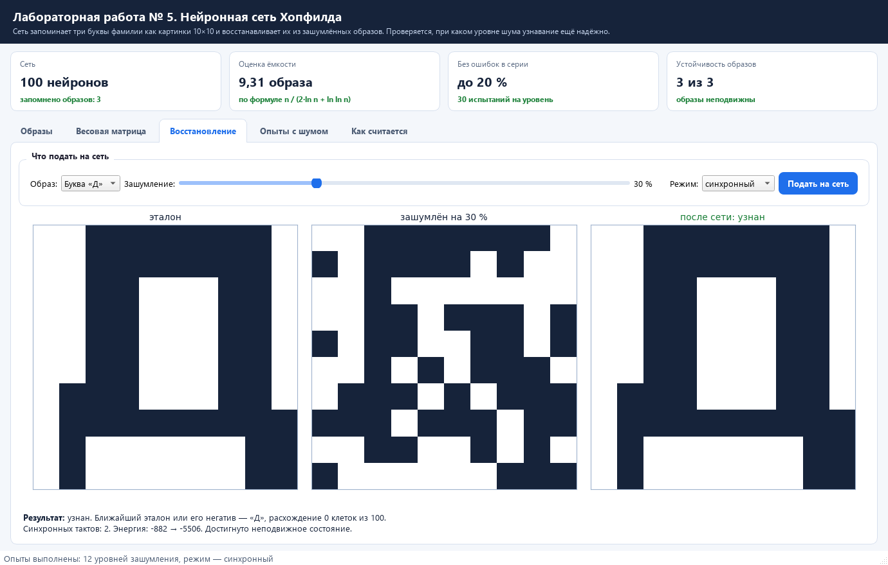
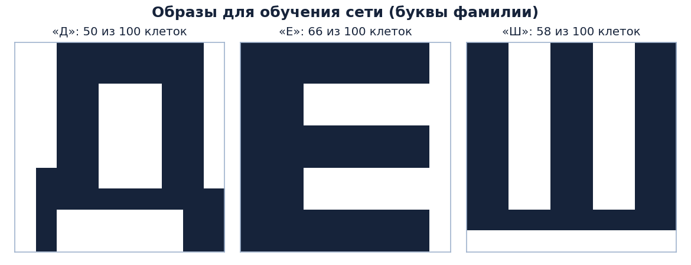
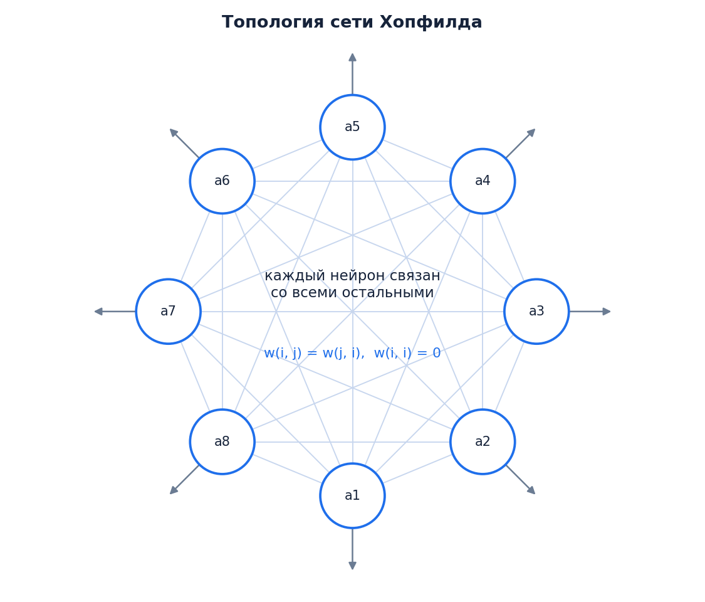
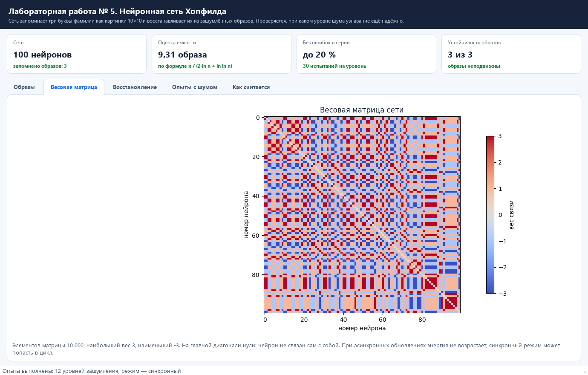
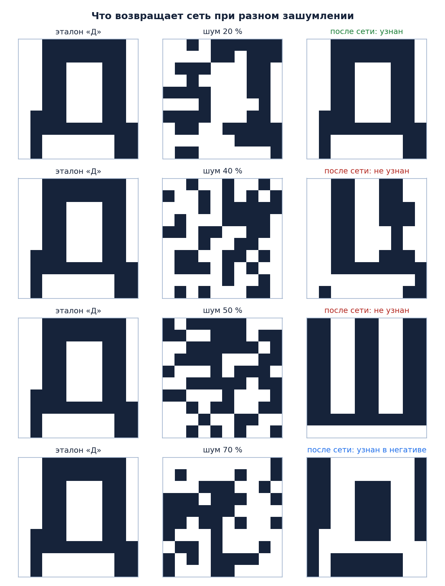
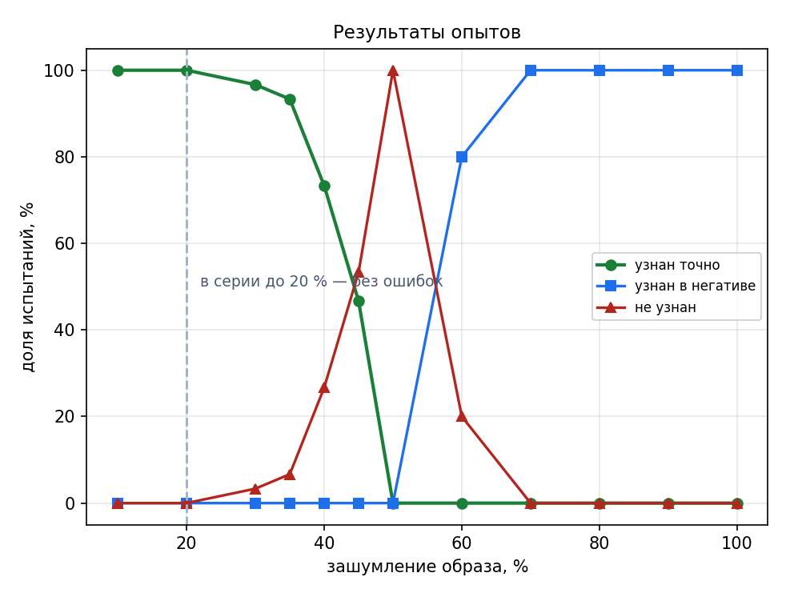
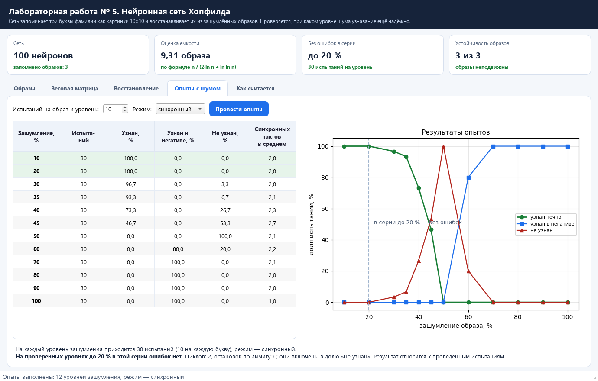
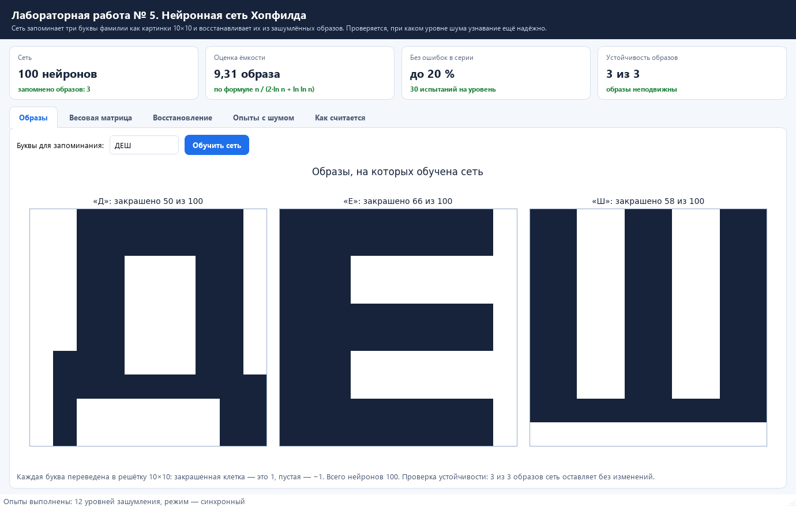

# Лабораторная работа № 5. Нейронная сеть Хопфилда

Дисциплина «Базы знаний и принятие проектных решений в САПР», **вариант 3**.
Лабораторная работа № 5 соответствует лабораторной работе № 9 методического пособия.

Сеть запоминает три буквы фамилии как картинки 10×10 и восстанавливает их из зашумлённых
образов. Программа проводит опыты по всем уровням зашумления из задания и показывает,
при каком шуме узнавание ещё надёжно.



---

## Содержание

1. [Условие задачи](#условие-задачи)
2. [Быстрый старт](#быстрый-старт)
3. [Образы для обучения](#образы-для-обучения)
4. [Как устроена сеть](#как-устроена-сеть)
5. [Восстановление зашумлённых образов](#восстановление-зашумлённых-образов)
6. [Опыты по заданию](#опыты-по-заданию)
7. [Ёмкость сети](#ёмкость-сети)
8. [Как пользоваться программой](#как-пользоваться-программой)
9. [Структура проекта](#структура-проекта)
10. [Тесты](#тесты)
11. [Ответ на вопрос задачи](#ответ-на-вопрос-задачи)

---

## Условие задачи

По заданию нужно:

1. написать программу, реализующую сеть Хопфилда;
2. обучить сеть на трёх образах — первых буквах своей фамилии в виде бинарных изображений
   (5×7, 10×10 или другого размера);
3. подать на вход зашумлённые образы (10, 20, 30, 35, 40, 45, 50, 60, 70, 80, 90 и 100 %),
   не менее десяти тестовых образов на каждый класс при каждом проценте зашумления;
4. проанализировать, при каком проценте зашумления образы распознаются верно.

Фамилия — **Дешев**, поэтому сеть обучается на буквах **Д**, **Е**, **Ш**. Размер картинки
10×10, то есть в сети 100 нейронов. Буквы в программе можно поменять: они рисуются
системным шрифтом, поэтому подойдут любые.

---

## Быстрый старт

Нужен Python версии 3.10 или новее.

### Windows (PowerShell или командная строка)

```bat
git clone https://github.com/dezshev/BZiPPRvSAPR-labs.git
cd BZiPPRvSAPR-labs
git checkout lab5

python -m venv .venv
.venv\Scripts\activate

pip install -r requirements.txt
python main.py
```

### Linux или macOS

```bash
git clone https://github.com/dezshev/BZiPPRvSAPR-labs.git
cd BZiPPRvSAPR-labs
git checkout lab5

python3 -m venv .venv
source .venv/bin/activate

pip install -r requirements.txt
python main.py
```

| Пакет | Зачем |
|---|---|
| `PySide6` | окно программы, таблицы, вкладки |
| `matplotlib` | картинки образов, весовая матрица, графики |
| `Pillow` | отрисовка букв системным шрифтом |

---

## Образы для обучения

Буква рисуется шрифтом системы и переводится в решётку 10×10: закрашенная клетка — это 1,
пустая — −1. Получается вектор из ста чисел, который и подаётся на сеть.



| Буква | Закрашено клеток | Отличий от соседних образов |
|---|---:|---|
| Д | 50 | от «Е» — 44 клетки, от «Ш» — 36 клеток |
| Е | 66 | от «Ш» — 44 клетки |
| Ш | 58 | — |

Образы заметно отличаются друг от друга, поэтому сеть уверенно их различает.

---

## Как устроена сеть



Сеть однослойная: выход каждого нейрона подаётся на входы всех остальных.

**Обучение.** Вес связи считается по формуле (4.1) из методических указаний:

```
w(i, j) = Σ a(i,k) · a(j,k)   при i ≠ j,      w(i, i) = 0
```

где `a(i,k)` — значение i-й клетки k-го образа. Матрица получается симметричной,
на главной диагонали нули.

**Работа.** Состояние нейрона на следующем такте — знак суммы входов:

```
a(i) = f( Σ w(i,j) · a(j) ),      f(x) = 1 при x > 0 и −1 при x ≤ 0
```

В **синхронном** режиме все нейроны меняются одновременно, в **асинхронном** — по очереди
в случайном порядке. Работа завершается при неподвижном состоянии, обнаружении
синхронного цикла или достижении лимита в 50 проходов. `run_detailed` возвращает причину
остановки: `fixed`, `cycle` или `limit`. Метод `run` сохраняет пару «состояние, счётчик».
В синхронном режиме считаются такты всей сети, в асинхронном — обновления отдельных нейронов.
Симметрия весов обеспечивает невозрастание энергии при асинхронных обновлениях;
синхронный режим может попасть в цикл длины два.

Проверка показала, что все три запомненных образа устойчивы: если подать эталон,
сеть возвращает его без изменений.



Красные клетки — положительные связи (нейроны чаще совпадают), синие — отрицательные.

---

## Восстановление зашумлённых образов

Зашумление на P процентов означает, что у P процентов клеток цвет меняется на противоположный.



Хорошо видно три случая:

* **20 %** — в показанном испытании сеть возвращает точный эталон;
* **40–50 %** — сеть уходит в чужое устойчивое состояние (на картинке это «Ш» вместо «Д»)
  или в смесь образов;
* **70 %** — в показанном испытании сеть приходит к негативу буквы.
  При шуме больше 50 % вход ближе к негативу по расстоянию Хэмминга, но переход к нему
  не гарантирован. Устойчивость исходных образов и их негативов проверяется отдельно.

---

## Опыты по заданию

На каждый уровень зашумления приходится по 10 испытаний на каждую букву — всего 30 испытаний
на уровень, как требует задание. Для воспроизводимости используется seed=2026 и образы,
показанные выше. Циклы и остановки по лимиту учитываются в доле «не узнан».

### Синхронный режим

| Зашумление, % | Испытаний | Узнан точно, % | Узнан в негативе, % | Не узнан, % | Верно для Д/Е/Ш | Тактов |
|---:|---:|---:|---:|---:|---|---:|
| 10 | 30 | **100,0** | 0,0 | 0,0 | 10/10/10 | 2,0 |
| 20 | 30 | **100,0** | 0,0 | 0,0 | 10/10/10 | 2,0 |
| 30 | 30 | 96,7 | 0,0 | 3,3 | 10/10/9 | 2,0 |
| 35 | 30 | 93,3 | 0,0 | 6,7 | 9/9/10 | 2,1 |
| 40 | 30 | 73,3 | 0,0 | 26,7 | 8/7/7 | 2,3 |
| 45 | 30 | 46,7 | 0,0 | 53,3 | 7/1/6 | 2,7 |
| 50 | 30 | 0,0 | 0,0 | 100,0 | 0/0/0 | 2,1 |
| 60 | 30 | 0,0 | 80,0 | 20,0 | 0/0/0 | 2,2 |
| 70 | 30 | 0,0 | 100,0 | 0,0 | 0/0/0 | 2,1 |
| 80 | 30 | 0,0 | 100,0 | 0,0 | 0/0/0 | 2,0 |
| 90 | 30 | 0,0 | 100,0 | 0,0 | 0/0/0 | 2,0 |
| 100 | 30 | 0,0 | 100,0 | 0,0 | 0/0/0 | 1,0 |



### Асинхронный режим

| Зашумление, % | Узнан точно, % | Узнан в негативе, % | Не узнан, % |
|---:|---:|---:|---:|
| 10 | **100,0** | 0,0 | 0,0 |
| 20 | **100,0** | 0,0 | 0,0 |
| 30 | 96,7 | 0,0 | 3,3 |
| 35 | 96,7 | 0,0 | 3,3 |
| 40 | 70,0 | 0,0 | 30,0 |
| 45 | 33,3 | 0,0 | 66,7 |
| 50 | 0,0 | 0,0 | 100,0 |
| 60 | 0,0 | 86,7 | 13,3 |
| 70 | 0,0 | 96,7 | 3,3 |
| 80, 90, 100 | 0,0 | 100,0 | 0,0 |

Результаты режимов близки, но доли распознавания различаются. При 50 % шума два из 30
синхронных запусков завершаются обнаружением цикла длины два; в остальных случаях получено
неподвижное состояние. В асинхронной серии циклов и остановок по лимиту нет.
Один асинхронный проход состоит из 100 обновлений; его нельзя сравнивать с одним обновлением
нейрона или считать, что проходов требуется в сто раз больше.



---

## Ёмкость сети

Оценка ёмкости по формуле (4.5) методических указаний:

```
m = n / (2·ln n + ln ln n) = 100 / (2·ln 100 + ln ln 100) ≈ 9,31
```

Это оценка, которая не гарантирует устойчивость произвольного набора образов.
Устойчивость каждой буквы проверена одним обновлением сети, а восстановление при шуме —
отдельными испытаниями. На него влияют сходство образов и расположение повреждённых клеток.

---

## Как пользоваться программой

1. **Образы** — поле для ввода букв и кнопка «Обучить сеть»: можно запомнить любые три буквы.
2. **Весовая матрица** — карта весов связей и сведения о них.
3. **Восстановление** — выбор буквы, ползунок зашумления и режим работы. Показываются три
   картинки: эталон, зашумлённый образ и то, что вернула сеть, а также число тактов
   и энергия состояния.
4. **Опыты с шумом** — таблица и график по всем уровням зашумления из задания; число испытаний
   на уровень задаётся.
5. **Как считается** — формулы обучения и работы сети.



---

## Структура проекта

```
BZiPPRvSAPR-labs (ветка lab5)
├── main.py                      запуск приложения
├── requirements.txt             список зависимостей
├── hopfield/
│   ├── patterns.py              буквы в виде решёток 10×10
│   ├── network.py               обучение, работа сети, зашумление и опыты
│   └── ui.py                    окно программы
├── tools/                       рисунки и снимки окна
├── tests/test_lab5.py           проверки сети и опытов
└── docs/
    └── img/                     картинки для README
```

Сеть можно использовать отдельно от интерфейса:

```python
import random

from hopfield.network import Network, add_noise, run_experiment
from hopfield.patterns import default_patterns

network = Network.train(default_patterns("ДЕШ"))
noisy = add_noise(network.patterns[0], 30, random.Random(1))
result = network.run_detailed(noisy.cells)
print(result.status, result.state == network.patterns[0].cells, result.steps)

experiment = run_experiment(network, per_level=10)
print(experiment.reliable_limit())      # 20
```

---

## Тесты

```bash
python -m unittest discover -s tests -v
```

Что проверяется:

* готовятся три образа, клетки принимают только значения 1 и −1, буквы заметно отличаются;
* матрица весов симметрична, на диагонали нули, вес равен сумме произведений элементов образов;
* запомненные образы устойчивы: сеть возвращает их без изменений;
* энергия не растёт при асинхронных обновлениях симметричной сети;
* синхронные циклы и остановки по лимиту не выдаются за сходимость;
* ёмкость считается по формуле из методических указаний;
* зашумление меняет ровно заданную долю клеток, а 100 % даёт точный негатив;
* при зашумлении 10 и 20 % образы восстанавливаются в выбранных тестовых испытаниях;
* опыты охватывают все уровни из задания, доли в сумме дают 100 %, а с ростом шума
  доля точных распознаваний в этой серии не увеличивается;
* граница серии без ошибок не перескакивает через неудачный уровень шума.

---

## Ответ на вопрос задачи

Сеть из 100 нейронов обучена на трёх образах — буквах **Д**, **Е**, **Ш**. Все три образа
устойчивы по прямой проверке. Оценка ёмкости по формуле равна 9,31 и не заменяет эту проверку.

**В данной серии на проверенных уровнях 10 и 20 % ошибок нет** — в обоих режимах все 30 испытаний
на уровень дали точное восстановление. В синхронном режиме дальше получено: 96,7 % при 30 %, 93,3 % при 35 %,
73,3 % при 40 % и 46,7 % при 45 % зашумления.

**При зашумлении 50 %** испорченная картинка одинаково далека и от буквы, и от её негатива,
но это само по себе не определяет результат работы сети. В данной серии точных восстановлений
нет, а два синхронных испытания попали в цикл; остальные завершились в посторонних состояниях.

**При 60 % шума** исходный негатив восстановлен в 80 % синхронных и 86,7 % асинхронных испытаний.
При 70 % доли равны 100 % и 96,7 % соответственно, а на проверенных уровнях 80, 90 и 100 % —
100 % в обоих режимах. Это результаты данной серии, а не гарантия для любого искажения.

Практический вывод: в проведённых испытаниях слабый шум восстанавливался лучше сильного.
Для оценки надёжности при других искажениях нужны дополнительные серии; одного изменения
числа нейронов недостаточно, чтобы гарантировать улучшение.

---